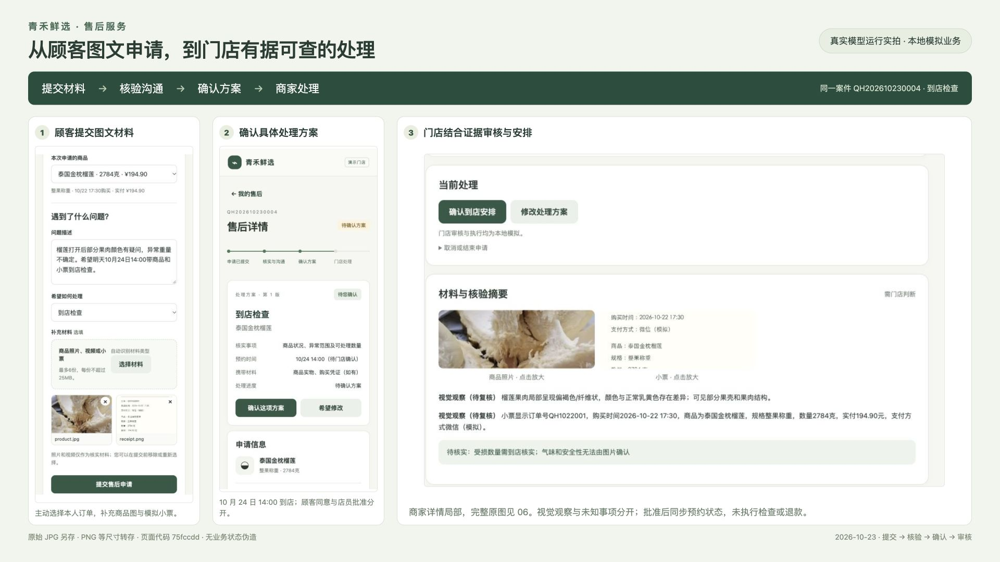
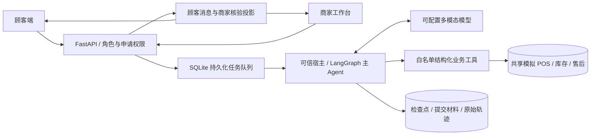

# 生鲜超市多模态售后 Agent

一个可以实际操作的门店售后 Demo：顾客提交文字、商品图片、小票或视频，Agent 通过白名单业务工具核验购买记录、补齐信息并形成处理方案；顾客确认后，由门店客服审核或接管。

**Python · LangGraph · FastAPI · SQLite · 原生 HTML/CSS/JavaScript · MIT**

> 所有账号、订单、库存、规则和资金处理均为本地模拟。公开版不包含原始购物小票、私人投诉素材、模型密钥、运行会话或私有评测答案。公开仓库是经过筛选的全新代码导出，不携带私有开发仓库历史。



## 能做什么

- **真正的新建申请**：顾客选自己的模拟订单和商品，或选择无订单/无小票；填写意向、预览并批量上传附件。
- **多模态材料理解**：通过可配置的视觉模型查看图片、小票和视频代表帧，记录材料类别、证据引用与不确定性。上传类型不是视觉事实，图片也不能直接证明气味、安全性或异常重量。
- **真实工具处理**：查询候选订单、订单明细、已有售后、库存、规则与营业时间；退款按整数分、历史额度及优惠分摊计算。
- **分类型方案**：退款、零退款换货和到店检查分别校验。方案版本、顾客同意、店员批准、模拟执行是不同状态；修改方案后旧同意失效。
- **异步与双端同步**：后台持久化任务队列、同申请串行处理、幂等操作和轮询更新；支持刷新、补材料及进程重启后恢复。
- **商家工作台**：真实统计、列表筛选、证据和核验摘要、方案修改、人工接管与审核。人工接管后自动服务停止对外回复。
- **共享模拟业务空间**：同一顾客的多笔申请共享购买、库存及售后历史，不通过复制数据库绕过重复处理约束。

## 快速启动

需要 **Python 3.11+（建议 3.12）**、FFmpeg/ffprobe，以及用于生成中文模拟小票的中文字体。

```sh
git clone https://github.com/ZJS-star/fresh-supermarket-after-sales-agent-public.git
cd fresh-supermarket-after-sales-agent-public
python3 -m venv .venv
source .venv/bin/activate
python -m pip install -r requirements.txt
cp .env.example .env
./demo.sh
```

`demo.sh` 使用 zsh；非 zsh 环境可执行：

```sh
python -m agent_mvp.demo.prepare
python -m uvicorn agent_mvp.api:app --host 127.0.0.1 --port 8000 --no-access-log
```

- 顾客端：<http://127.0.0.1:8000/>
- 商家端：<http://127.0.0.1:8000/staff>
- 演示控制台：<http://127.0.0.1:8000/console>
- API 文档：<http://127.0.0.1:8000/docs>

如果本机8000端口已有开发服务，可用`PORT=8020 ./demo.sh`另开一个互不混用业务数据的演示服务。

点击页面中的预置身份进入；顾客小林、小陈和门店客服的会话与订单范围分别校验。它们是本机演示身份，不是生产登录系统。

macOS 可使用系统中文字体；Linux 可安装 `fonts-noto-cjk` 和 `ffmpeg`，或在运行前设置 `DEMO_FONT_PATH` 为已有中文字体路径。仓库不分发系统字体。

## 模型配置与离线软件测试

`.env.example` 默认不含模型名和密钥。真实多模态运行需要在本地 `.env` 中配置同时支持**图像输入和结构化工具调用**的 Chat Completions 兼容接口：

```dotenv
MODEL_BASE_URL=https://your-provider.example/v1
MODEL_NAME=your-vision-model
MODEL_API_KEY=
MODEL_TIMEOUT_SECONDS=90
MODEL_MAX_TOKENS=1600
MODEL_TOKEN_LIMIT_FIELD=max_completion_tokens
# 厂商支持时可填写 false；不支持则留空，不发送该参数。
MODEL_ENABLE_THINKING=
```

密钥只由后端读取。不要放进网页、截图、README 或 Git。无配置时不会偷偷调用其他模型，申请仍会保存，可由店员接待。

无需密钥即可检查界面与业务链路：

```sh
./demo.sh --software  # 端口 8001，明确标记为软件测试模式
# 或
python -m agent_mvp.demo.prepare
python -m uvicorn agent_mvp.demo.software:app --host 127.0.0.1 --port 8001
```

**软件模型不识别图片，不是多模态模型成绩。** 控制台提供的商品样例是代码生成的占位图，不能用它宣称识别了商品异常；真实视觉联调请上传自己的商品图片。生成小票对应本空间的虚拟 POS，不篡改真实凭证。

## 推荐体验路径

1. 顾客选择榴莲订单，描述外观疑问，上传自己的商品图与控制台生成的小票。
2. 对于无法确定的受损重量，讨论到店检查；填写未来营业时段内的到店时间。
3. Agent 查询工具并保存具体方案，顾客确认当前版本。
4. 商家查看订单、材料、观察和未知事项，再批准预约或修改方案。
5. 顾客自动看到“已安排到店”，确认按钮消失。该状态仅表示预约安排确认，未执行实物检查或退款。
6. 另建无票申请，体验人工接待；或选择库存为 0 的葡萄，检查缺货约束及替代方案确认。

演示业务时钟固定为 **2026-10-23 10:00（北京时间）**，模拟购买时间为前一天。示例预约可选 10 月 24 日营业时段。控制台重置会生成新空间并保留旧空间；日期种子修改不会改写旧记录。

## 架构



模型不能读取任意文件、执行 shell、填写宿主幂等键，或自行批准退款/换货。订单选择由登录范围和独立 POS 校验；小票 OCR 是顾客证据，不会同时当成独立收银事实。顾客可见信息与内部工具记录分开，完整轨迹保存在本地 `.demo/`。

| 目录 | 职责 |
|---|---|
| `agent_mvp/runtime.py`、`schemas.py` | LangGraph 宿主、状态、工具协议和业务边界 |
| `agent_mvp/model.py`、`media.py` | 模型适配、已提交媒体、视频帧与证据引用 |
| `agent_mvp/demo/` | 双端 API、任务、共享业务空间与前端 |
| `after_sales_dataset/tools.py`、`controls.py` | 业务工具、确认及幂等约束 |
| `after_sales_dataset/snapshot/` | 无业务行、无凭据的数据库表结构 |
| `tests/` | 可独立运行的软件回归，不依赖私有素材 |
| `docs/screenshots/` | 先前实际浏览器流程截图，交易与顾客均为模拟 |

## 验证与截图

```sh
python -m pytest -q
python scripts/security_scan.py
```

本次公开版执行了15项软件测试，全部通过；这些测试不需要私有评测素材或模型密钥。截图来自此前实际开发运行，其中主流程调用了真实视觉模型，再由真人扮演顾客与店员进行确认/审核；不是公开版启动时自动重放的预填案件，也不代表模型任务成功率。

截图：[新建申请](docs/screenshots/02_customer_new_request.png) · [具体方案](docs/screenshots/04_customer_proposal.png) · [商家核验](docs/screenshots/06_merchant_review.png) · [顾客结果](docs/screenshots/07_customer_result.png)。浏览器原生只提供 JPEG，展示 PNG 为等尺寸转存，不能描述为原生高倍无损截图。

## 安全与已知限制

- 发布前进行了已知本地密钥匹配、常见凭据格式、私钥、文件树及 Git 对象扫描；**在本次检查范围内未发现公开文件中的真实密钥或访问凭据**。范围及剔除项见 [公开发布检查](docs/PUBLIC_RELEASE_REVIEW.md)。
- `.env`、上传文件、Cookie/能力凭据、请求正文和运行数据库留在本机，不随版本控制发布。完整原始小票、OCR、私有案例/标准答案及历史轨迹不分发，旧评测案例入口因此为空。
- 仅适合本机、单个 uvicorn worker 的 Demo。公开代码仓库不等于可直接公网部署；生产部署需要真正的认证、对象存储、队列和数据保护措施。
- 模型可能误读、反复追问或响应较慢；视觉事实与方案语义仍需人工复核。没有用软件测试或参考路径冒充真实 Agent 成绩。
- 未连接真实支付、退款、消息渠道；所有执行都是 SQLite 内的模拟记录。

## License

项目代码使用 [MIT License](LICENSE)。私人原始商品投诉和购物凭证未包含在公开发行中；演示截图用于说明本模拟系统的实际交互。
